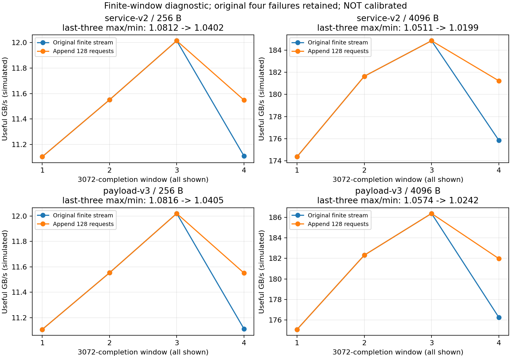

# 随机曲线未达稳态：有限窗口与机制检查

本轮保留 `turnover-v3` 的全部数据、四个失败结论和 5% 判据。
没有改 sense、链路、调度器或缓存策略，没有拟合参数，也没有恢复 ANNS 性能实验。
诊断协议单独冻结为 `calibration/random-window-v1/protocol.json`。

## 因果对照

原工作负载是同一 3072 页随机排列连续四轮，父请求 QD128。
等完成数窗口包含启动和最终排空，它并不是无限流的稳态采样。
本次只在末尾追加同一排列的前 128 个请求，仍按原来每 3072 次完成分窗，
比较前四个窗口。末尾追加是诊断干预，不能把旧失败重新归类为通过。

必须首先验证原轨迹前 12160 次完成及相应边界前的 sense 事件完全相同。
这样才能把后续差异归于有限流终止条件，而不是偷偷更改早期执行。
有保护尾段的曲线也仍使用原来的 5% 数值门槛，但只是因果对照，
不是新校准验收；本次未证明更长随机流、其它种子或其它 QD 的稳态。

## 本轮结果

| 链路 / 请求 | 原后三窗口 max/min | 追加尾段后 | 原结论 |
|---|---:|---:|---|
| v2 / 256B | 1.081222 | 1.040240 | 仍失败 |
| v3 / 256B | 1.081632 | 1.040532 | 仍失败 |
| v2 / 4096B | 1.051062 | 1.019939 | 仍失败 |
| v3 / 4096B | 1.057407 | 1.024159 | 仍失败 |

复现说明：冻结协议中的“same binary”字样不够精确。尾段运行统一使用上一轮
提高累计 logical-fragment 输入上限后的二进制 `f1ef2ae6…`；部分原始短请求档案
来自此前二进制。两者只差输入数量保护上限，不改模拟时序；逐事件前缀等价是实测检查。
这项差异保留为协议偏差，不能声称全部原始/对照二进制哈希相同。

四组运行均 exit 0，前 12160 个完成记录及边界前 sense 事件完全一致。
这证明终止条件足以影响本次判据结果，不能据此宣称所有随机流已经稳态。
原始及追加尾段数据、协议摘要、二进制摘要、逐窗口守恒计算保存在
`calibration/random-window-v1/`，旧数据未覆盖。

原始四组各有 24 个无 sense 父请求，集中于六个 bank。
独立地址映射和请求区间检查排除了这些夹具中的同页并发合并；每次 sense 恰有一个父请求，
无 sense 请求都与独立 FIFO 模型中的 ready 驻留区间相交。
这是驻留可行性检查，尚未独立重建全部 pin-release 时刻。
另加定向主路径测试：先暖 A、B，再以不同 ID 提交 C、A、B；B 在 C sense 期间完成，
只发生 C、A 两次 sense。两种链路模式都符合此独立预期。
因此不能把较少的 sense 直接判为漏算，也不能由这个定向结果宣称所有缓存竞争已证明正确。



## 两套独立记账及机制检查

Python 审计器不调用 EventLab 实现：

- 每 bank 的 sense 必须成对、身份/页号匹配、持续 2720000ps，且不可重叠。
- busy 积分分别由逐区间裁剪与事件增减扫描计算，结果必须整数精确一致。
- 完成的 sense 工作量加上两端未完成 sense 已执行工作量之差，必须等于窗口 busy 积分。
- 父请求的提交时刻必须满足 QD128 closed-loop；占用积分必须等于全部请求延迟之和，结束占用为零。
- 另外使用关闭 FCFS/Device 索引的扫描实现，对两种链路模式、256B/4KiB、并发/依赖及三页周转的六组固定种子夹具逐字节对比全部输出和事件摘要。

扫描与索引差分共享设备核心，只能证明索引优化等价，不能单独证明设备模型正确；
区间积分、手算重叠区间及定向缓存 oracle 则不调用该核心。

这能排查事件漏计、时间倒退、资源重叠、索引实现偏差等问题；
它不构成对全部设备协议和任何负载的正确性证明。程序未发现错误不等于模型已物理校准。

## 为什么完成数相同仍不能视为工作量相同

窗口端点可落在一批 sense 的不同阶段。以原 v3/256B 为例，第三窗口完成
3061 次 sense，但该窗口内实际执行工作仅相当于约 2955.15 个完整 sense：
相当一部分工作在窗口开始前已做完。只比较 3072 个父请求的完成数，会漏掉这笔跨窗口工作。
最后窗口还包括最终排空，bank 平均忙碌数由第三窗口约 122.85 降至约 117.51。
这些量由事件精确守恒关系计算，并非拟合解释。

## 外部带宽证据不能混用

[OCP v0.7](https://www.opencompute.org/documents/ocp-hbf-architecture-specification-v0-7-0-final-pdf/)
Table 2 的 75% 包含 AXI 效率；Table 4 列出用户带宽，§5.1.2 则列单模块系统带宽。

| 等级 | 原始 GB/s/模块 | 系统 GB/s/模块 × 模块数 | Table4 用户 GB/s |
|---|---:|---:|---:|
| SG1 | 64 | 48×8=384 | 384 |
| SG2 | 128 | 94×16=1504 | 1536 |
| SG3 | 256 | 188×16=3008 | 3072 |

SG2/3 的两组数相差 2.08333%；所查条款没有解释差额。不能据此推导固定 16B 包头，
也不能把原始带宽直接当有效载荷带宽。v3 仍沿用有标签的 94GB/s 聚合解释，未为贴合峰值改参数。

[RETRIEVE 论文](https://research.ece.cornell.edu/retrieve/camera-ready/retrieve26-final50.pdf)
Table II 采用 OCP 用户带宽，IV.C 明说名义 sense 时间按 SG2 吞吐标定。
因此 Fig.3(b) 是该参数下的一致性检查，不是独立硬件真值；精确轨迹、QD 和时间窗口仍未拿到。
此前 `LINK_PAYLOAD_V3_ZH.md` 把此链接标作 HEAVEN/RETRIEVE，本轮已更正名称。

[HAVEN v1 §3.2](https://arxiv.org/html/2603.01175v1) 则使用 8-Hi、每 stack 30W 的功耗约束，
以及假设的 460GB/s/stack HBM2E 上限。它基于 3D-FPIM/NeuroSim 的建模路径，
不能直接当作上述 16-channel OCP 配置的数值验收目标。

本轮没有拟合集；追加尾段是针对已见失败的诊断，不冒充未见校准验证集。
未来拟合必须另立训练数据，冻结参数后再使用独立轨迹和完整曲线验证。
`hardware_calibrated`、`paper_curve_reproduced`、`performance_ready` 均保持 false。

## 回归与复现

```sh
python3 tests/random_window_contract.py
python3 scripts/random_window_audit.py calibration/turnover-v3/20261124/results calibration/random-window-v1/guard /tmp/random-window-audit
python3 tests/cache_overlap_contract.py build/cache_overlap_probe
python3 tests/random_window_diff.py build-device-reference/turnover_probe build/turnover_probe /tmp/random-window-diff
```

负向检查包含 32 个轨迹破坏、1 个超容量反例、12 个差分输出破坏和 6 个定向缓存轨迹破坏。
这些测试检查审计器能拒绝相应错误，不代表穷尽所有实现故障。
Linux 新定向测试使用全库 ASan/UBSan；原始日志位于 `validation/`。
上次提交 `93b7907` 的 [CI 已成功](https://github.com/kexinchu/anns-hbf-sim/actions/runs/45493333204)；
此状态不能代替本轮提交的 CI，后者须按提交 SHA 单独核实。

本轮本地 CHECK 模式完整回归：43/43 通过。扫描/索引六组差分及上述负向检查通过。
